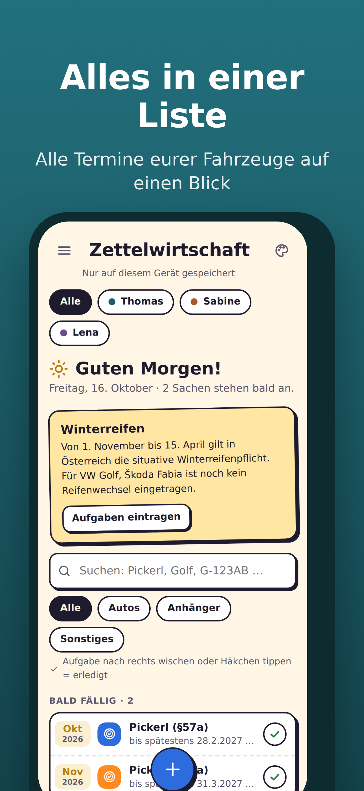

# Zettelwirtschaft

Die Familien-App für Autos, Anhänger und sonstige Fahrzeuge: Pickerl, Reifenwechsel, Service, Tanken und alle Kosten. Gemacht für Österreich.

## Funktionen

**Autos, Anhänger und Sonstiges** (z. B. Motorrad, Wohnwagen)
- Pickerl (§57a) mit Toleranzfrist: zeigt, ab wann man hinfahren kann (ein Monat vorher) und bis wann es spätestens sein muss (vier Monate danach)
- Reifenwechsel mit Erinnerung an die situative Winterreifenpflicht (1. November bis 15. April)
- Vignette, Service, Ölwechsel, Reparaturen
- Tankbuch mit Verbrauch (l/100 km) und Spritkosten
- Werkstatt-Verlauf mit allen Kosten

**Außerdem**
- Alles einer Person aus der Familie zuordnen und nach Person filtern
- Fotos und PDFs von Rechnungen und Zulassungsscheinen
- Auswertung der Kosten nach Monat, Fahrzeug und Person
- Termine in den Google Kalender übernehmen
- Export und Import (mit oder ohne Fotos), Excel-Export
- Funktioniert offline und lässt sich am Handy wie eine App installieren
- Hell- und Dunkelmodus

## Datenschutz

Alle Daten bleiben **ausschließlich lokal im Browser** des jeweiligen Geräts (localStorage und IndexedDB). Es gibt keinen Server und kein Konto, und es wird nichts übertragen.

Deshalb gilt: Wer die Browserdaten löscht oder das Gerät verliert, verliert ohne Export auch die Daten. Regelmäßig unter **Mehr → Export & Import** exportieren.

## Online stellen mit GitHub Pages

1. Neues Repository auf GitHub anlegen, z. B. `zettelwirtschaft`.
2. Alle Dateien aus diesem Ordner hochladen („Add file → Upload files“).
3. Im Repository auf **Settings → Pages** gehen.
4. Bei **Source** „Deploy from a branch“ wählen, Branch `main` und Ordner `/ (root)`, dann speichern.
5. Nach ein bis zwei Minuten ist die App erreichbar unter
   `https://DEIN-BENUTZERNAME.github.io/zettelwirtschaft/`

Hinweis: Auf GitHub Pages ist die Seite öffentlich erreichbar. Das ist unbedenklich, weil keine Daten auf der Seite selbst liegen. Jeder, der sie öffnet, hat nur seine eigenen, lokalen Daten.

## Am Handy installieren

- **iPhone (Safari):** Seite öffnen → „Teilen“ → „Zum Home-Bildschirm“
- **Android (Chrome):** Seite öffnen → Menü (drei Punkte) → „App installieren“

Die App hat dann ihr eigenes Symbol und funktioniert auch ohne Internet.

## Updates veröffentlichen

Nach einer Änderung an `index.html` in `sw.js` die Versionsnummer erhöhen (z. B. `zettelwirtschaft-v1` → `zettelwirtschaft-v2`). Dann laden installierte Apps beim nächsten Öffnen mit Internet die neue Version.

## Aufbau

| Datei / Ordner | Inhalt |
|---|---|
| `index.html` | Die komplette App (HTML, CSS und JavaScript in einer Datei) |
| `manifest.webmanifest` | App-Name, Farben und Symbole für die Installation |
| `sw.js` | Service Worker für den Offline-Betrieb |
| `icons/` | App-Symbole in allen Größen |
| `store-bilder/` | Screenshots und Feature-Grafik für App-Stores |

Externe Abhängigkeiten werden nur bei Bedarf geladen: die Schriften Bricolage Grotesque und Manrope von Google Fonts sowie SheetJS für den Excel-Export von cdnjs.
